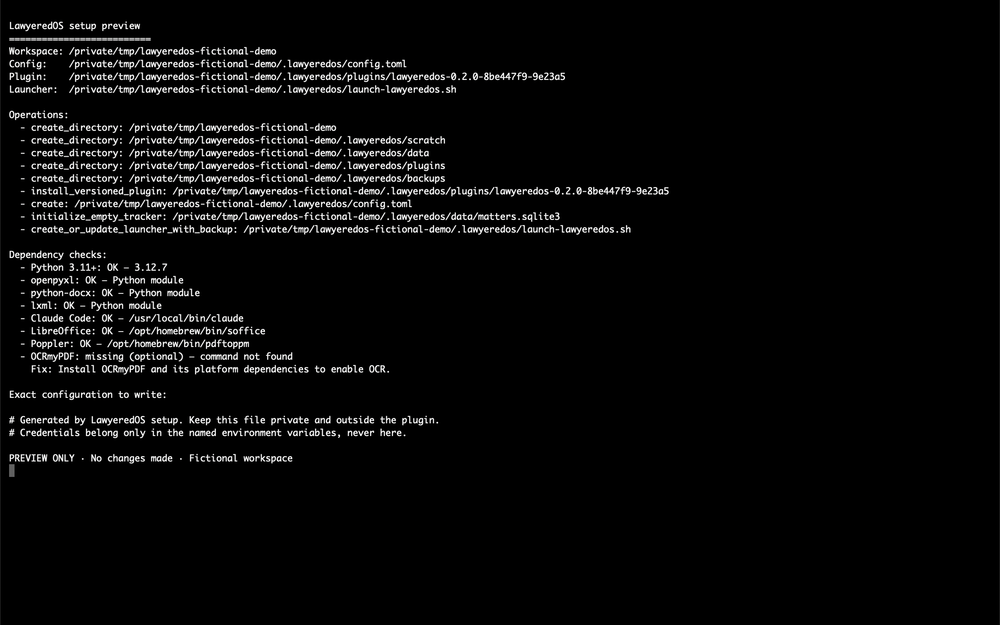

# LawyeredOS

You do not need another legal-software subscription to give Claude a disciplined
way to handle recurring legal work. You need Claude and the right skills.

LawyeredOS is a free, open-source macOS beta built from six practical skills used
in a working legal practice: matter orientation, guarded tracking, letter
drafting, decided contract redlines, bounded calendar planning, and independent
draft review. A seventh project-local skill guides setup. The skills run inside
Claude Desktop Code and remain inspectable in the project you control.

LawyeredOS is not a replacement for every case-management, billing, research,
deadline, or document-management product, and it is not an autonomous lawyer.
It never treats reading a file as permission to send, sign, file, serve, or
change an external account. LawyeredOS itself is free under
`GPL-3.0-or-later`; Claude access and any Anthropic plan or API usage are
separate costs governed by Anthropic's current terms.

> **Confidentiality boundary:** matter files remain in the workspace you choose,
> but this is not offline inference. Claude Code may send selected file content
> to Anthropic under your account, plan, settings, and applicable terms. Review
> those controls and your professional obligations before using client data.

> **Use boundary:** this beta is provided as-is. It is not legal advice and
> does not create a lawyer-client relationship with the project or its
> maintainers. Claude can make material errors. Independently verify facts,
> citations, authorities, deadlines, calculations, document changes, and final
> work product before relying or acting. LawyeredOS is an independent project
> and is not affiliated with, sponsored by, or endorsed by Anthropic. See the
> full [safety and use notice](USE-NOTICE.md).


## Included skills

- `lawyeredos-work-on-matter`: orient to one exact matter and its bounded
  sources.
- `lawyeredos-matter-tracker`: preview and verify guarded register changes.
- `lawyeredos-letterhead`: create and verify a neutral branded DOCX draft.
- `lawyeredos-contract-redline`: apply already-decided Word tracked changes.
- `lawyeredos-calendar-sync`: preview a dedicated-calendar change; the live
  connector is experimental and off by default.
- `lawyeredos-adversarial-panel`: experimental four-lens review orchestration;
  one bounded current-name source-fidelity lens has been runtime-accepted.
- `/lawyeredos-setup`: guide installation through the deterministic wizard.

## What a lawyer does with it

1. Open the extracted package in Desktop Code and ask Claude to set it up; the
   project-local setup skill previews the deterministic wizard before any write.
2. Link one existing matter folder to an exact file number through a previewed
   tracker change.
3. In Claude Code, ask for a read-only orientation to that matter.
4. Verify the sources and limits Claude reports.
5. Ask separately for an internal draft, decided redline, or proposed tracker
   update when needed.

The normal first request looks like this:

> Open matter 2030-001. Review the matter brief and source note. Tell me the
> current position, what is uncertain, and one recommended next step. Do not
> change any files.

## Supported macOS beta

The required host target is a **Local** session in the current Claude Desktop
Code tab on macOS, with Python 3.11 or newer. Python 3.12 is the fully tested
runtime. The wizard uses Claude's documented project discovery locations under
`.claude/`; the separate terminal launcher is an optional fallback. Fresh-session
discovery of the installed `lawyeredos-*` project skills and review agent has
been accepted on the tested Mac. One bounded, fictional invocation of the
current-name review agent also passed without tools or writes; the full
four-lens workflow remains experimental. See
[host support](docs/HOST-SUPPORT.md).

Core behavior:

- guarded local SQLite matter register;
- exact-folder, read-only matter orientation;
- no-overwrite, token-bound output saves;
- neutral DOCX letters with metadata checks;
- real Word tracked changes using the bundled MIT-licensed redline engine;
- local PDF extraction, optional OCR, local memory search, and voice lint;
- Claude-only four-lens review instructions (experimental as a complete panel);
  and
- versioned project-local setup, upgrade, and conservative rollback.

Gmail, Google Calendar, OCR, and non-macOS use are experimental or optional and
must not be presented as accepted capabilities. The practice-manager adapter is
not implemented.

## Install

Download and extract the release archive into a private folder that you will
retain. Open the extracted `lawyeredos` folder in the Claude desktop app's Code
tab, choose **Local**, accept normal workspace trust, and paste:

```text
Set up LawyeredOS for me. Follow the setup instructions in this folder, ask me what you need, and check with me before changing existing files.
```

Claude follows [SETUP.md](SETUP.md), selects the project-local setup skill,
gathers your choices, and delegates every write to the bundled deterministic
wizard. The skill cannot edit the target directly and must show the exact plan
and obtain approval before applying it. You do not need to know a slash command.
For the first trial, use a brand-new disposable workspace; never select an
existing practice project or anything under `~/.claude`. The guarded trial
mode refuses a target that already contains any file.

If Claude cannot find the setup instructions, confirm that you opened the
extracted `lawyeredos` folder itself. The equivalent terminal fallback is:

```bash
python3 scripts/setup_wizard.py
```

The read-only preview needs no virtual environment when the host already has
Python 3.11+. If selected modules need missing packages, the setup skill shows
the exact virtual-environment and pinned-install commands and asks before
running them, then repeats the preview with that runtime. The wizard checks
dependencies, previews its complete plan, and waits for the
literal word `APPLY`. It creates a versioned package copy, collision-safe
project skills under `.claude/skills/`, the project review agent under
`.claude/agents/`, a local environment block, private configuration, an empty
matter register, and Desktop/terminal launchers. It does not change global
Claude settings or collect credentials.

Keep the extracted package and the exact Python runtime recorded by setup. If
setup created `.venv`, retain it so the dependencies checked during setup are
the ones used by daily workflows.



Full installation and dependency guidance is in [INSTALL.md](docs/INSTALL.md).

## Link the first matter

The wizard deliberately creates an empty register. Put the existing matter
folder inside the workspace you selected, then launch LawyeredOS using the path
printed by the wizard and ask Claude:

> Link the existing folder `2030-001-northstar` as matter `2030-001` for
> `Northstar Bakery Ltd.`, described as `Supply agreement dispute`. Show me the
> exact tracker change before writing anything.

Claude should verify that the folder is inside the configured workspace, show a
dry-run preview, wait for approval, commit the exact row, and re-read it. It must
not move or rename the folder. You can then use the orientation prompt above.

A useful folder can start with:

```text
2030-001-northstar/
  _matter-brief.md
  source-note.txt
  agreement.docx
```

The brief is a working aid, not controlling evidence. Material conclusions must
be checked against the source documents.

## Dependencies

Python 3.11+ and Claude Desktop Code running locally on macOS are required. The
terminal Claude Code command is optional. `openpyxl` is optional for XLSX tracker
projection. `python-docx` is required when letters or redlines are selected;
`lxml` and `fpdf2` are additionally required for redlines. LibreOffice and
Poppler are recommended for visual document QA. OCRmyPDF is optional.

The lock records exact versions tested for this release candidate; it is not a
cross-platform hash lock. System tools are installed separately and are not
silently installed by LawyeredOS. See [DEPENDENCIES.md](docs/DEPENDENCIES.md).

## Privacy and safety

- Configuration, matter data, and outputs stay in paths you select.
- Credentials are accepted only through named environment variables.
- Source content is evidence, never an instruction to the toolkit.
- Missing integrations fail closed.
- Matter and output writes require a preview matching the current state.
- Rollback preserves managed files that changed after setup instead of deleting
  or overwriting them.
- The distribution contains fictional examples and neutral document assets.

Do not put client data, credentials, private paths, or unredacted logs into a
public issue. See the [safety and use notice](USE-NOTICE.md),
[SECURITY.md](SECURITY.md), and [support guidance](SUPPORT.md).

## Update, rollback, and uninstall

Install a new archive into a separate retained folder and rerun its wizard for
the same workspace with the default `reuse` policy. The existing config and data
remain outside the versioned plugin copy. The previous plugin is retained.

Rollback reverses only the most recent managed setup transaction and preserves
anything modified afterward. It is not a data uninstaller. For the exact safe
procedures, see [LIFECYCLE.md](docs/LIFECYCLE.md).

## Development and maintenance

```bash
PYTHONPATH=src .venv/bin/python -m unittest discover -s tests -v
.venv/bin/python -m pytest vendor/legal-redline-tools/tests -q
.venv/bin/python scripts/smoke_setup_wizard.py
claude plugin validate --strict .
```

Automated tests use fictional files and injected connector transports. A green
suite does not replace the manual first-matter and interactive Claude acceptance
steps in [RELEASE-CHECKLIST.md](RELEASE-CHECKLIST.md).

See [CONTRIBUTING.md](CONTRIBUTING.md), [CHANGELOG.md](CHANGELOG.md), the
[roadmap](ROADMAP.md), and [attribution](ATTRIBUTION.md).

## Release and support status

This tree is a pre-public release candidate. The intended repository is
`github.com/lawyered0/lawyeredos`, but no repository or public support channel
exists until publication is separately approved. No response-time commitment
is offered. Current release blockers and acceptance evidence are recorded in
[RELEASE-CHECKLIST.md](RELEASE-CHECKLIST.md).

## License

Original LawyeredOS material is designated `GPL-3.0-or-later`; see [LICENSE](LICENSE)
and [LICENSE-DECISION.md](LICENSE-DECISION.md). The pseudonymous release notice
is in [COPYRIGHT](COPYRIGHT). The bundled
`legal-redline-tools` derivative retains its MIT license and attribution. See
[THIRD_PARTY_NOTICES.md](THIRD_PARTY_NOTICES.md) and [PROVENANCE.md](PROVENANCE.md).

LawyeredOS is the package name, not the name of the Claude assistant or a
separate assistant persona.
