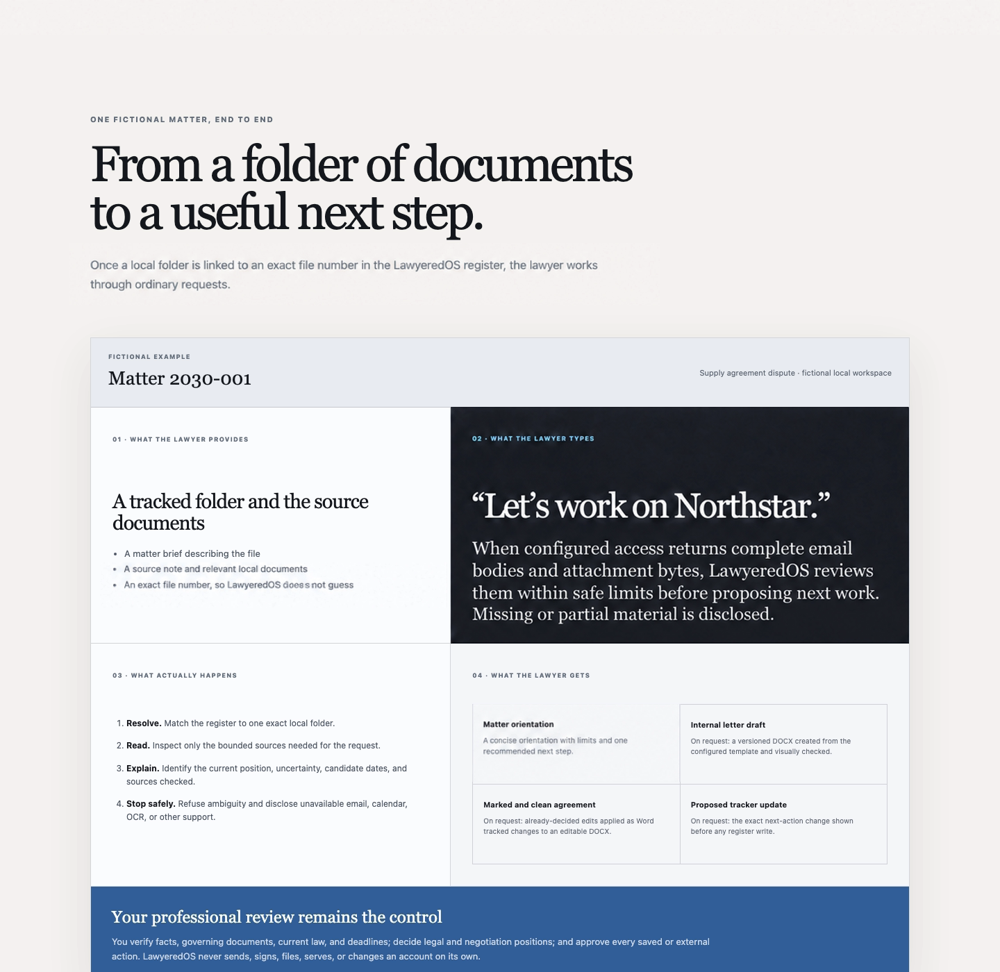

# LawyeredOS

**Legal-work skills for Claude or Codex—not another legal SaaS dashboard.**

LawyeredOS is a free, open-source macOS beta for Claude Desktop Code and
Codex local projects. Both hosts use the same Python, SQLite, document,
redline, and guarded-workflow core. Host-specific setup and discovery files
stay separate under `.claude/` and `.agents/`.

This branch contains an **unreleased 0.2.3 beta.1 instruction candidate** based on
published [0.2.2 beta.1](https://github.com/lawyered0/lawyeredos/releases/tag/v0.2.2-beta.1).
It adds shared review/record contracts and nine manually loaded specialist or
practice-attention modules. It changes no Python behavior or published download.
Read the [workflow catalog](docs/WORKFLOW-CATALOG.md),
[gap dispositions](docs/WORKFLOW-COMPLETENESS.md) and
[candidate release plan](docs/WORKFLOW-RELEASE-PLAN.md) for availability and limits.
Historical download and acceptance records below are retained; they do not
establish acceptance of these additions.

It works with the matter files you choose, records matter history and state in
your workspace, and helps identify and execute the next step under lawyer
oversight. Included workflows cover matter orientation and tracking, letters,
decided contract redlines, calendar planning, and independent draft review.



## Download a reviewed beta

| Host | Download | SHA-256 |
|---|---|---|
| Claude Desktop Code Local | [0.2.2 beta.1](https://github.com/lawyered0/lawyeredos/releases/download/v0.2.2-beta.1/lawyeredos-0.2.2-macos-beta.1.zip) | `b9bb69afde0b62d4a4a4211cad8ff08e98d1d376f688c149d10a5805b2e640ee` |
| Codex local project | [0.2.2 beta.1](https://github.com/lawyered0/lawyeredos/releases/download/v0.2.2-beta.1/lawyeredos-0.2.2-macos-codex-beta.1.zip) | `b9bb69afde0b62d4a4a4211cad8ff08e98d1d376f688c149d10a5805b2e640ee` |

The versioned release ZIPs remain on the
[LawyeredOS download site](https://www.lawyered.lawyer/lawyeredos). This source
repository is the place for review and contributions. Earlier versioned ZIPs
remain immutable; the version and checksum published beside each download are
its release boundary.

For continuity, earlier reviewed archives remain available with their original
SHA-256 checksums: Claude beta.2
`0f3eccf6e62e0bcb7ffbb88a6c14dd2f96c8a05acba73b93bb4bff3173af7cd5`
and Codex beta.1
`b468300f81bfdcc88398964a2808f6484c5cd2fb56b44d48e6721ab2d7d6e366`.

## Safe first trial

Extract the package for your host into a private folder you will retain. For
Claude Desktop, open its folder in the **Code** tab and choose **Local**. For
Codex, open its folder as a local Codex project. Then paste:

```text
Set up LawyeredOS for me in a new private workspace. Use fictional data, show me the complete plan, and check with me before changing files.
```

The released Claude beta also supports its original equivalent prompt:

```text
Set up LawyeredOS for me. Follow the setup instructions in this folder, ask me what you need, and check with me before changing existing files.
```

The setup skill gathers your choices, shows the exact plan, and waits for
approval before the deterministic installer writes anything. Start with a new,
empty workspace and fictional data. Claude setup is documented in
[SETUP.md](SETUP.md); Codex setup and its tested boundaries are in
[CODEX.md](CODEX.md).

Additional guidance: [installation](docs/INSTALL.md) ·
[host support](docs/HOST-SUPPORT.md) ·
[troubleshooting](docs/TROUBLESHOOTING.md)

## Pick up a matter where you left it

After setup, normal use is just a natural-language request:

> Let’s work on Northstar.

LawyeredOS then finds the one matching saved matter, reads its recorded state
and relevant local files, and—when read-only email access is both configured
and actually available—checks a bounded matter-specific slice for new messages.
It retrieves complete message bodies and safely retrieved supported
attachments, extracts bounded paragraph/page/sheet-aware chunks, and requires
the active host to acknowledge every exact chunk with locator-linked review
evidence before summarizing where things stand. Long content resumes across
chunks and sessions instead of being silently truncated. Safe attachments are
saved to the resolved matter folder; source IDs, SHA-256 hashes, extracted
chunks, and acknowledgement evidence are recorded in the private local review
ledger for progress and deduplication. See
[the review protocol](docs/CONTENT-REVIEW.md).

If the matter name is missing or ambiguous, it stops and asks instead of
guessing. If email access, search coverage, a message body, attachment bytes,
OCR, or document extraction is unavailable or incomplete, it says so and does
not mark that material fully reviewed. It does not assume chat memory is
complete, poll in the background, or claim that unavailable sources were
checked.

From there, say what you want to do next—for example, draft a response, review
an agreement, or propose a tracker update. LawyeredOS does not send, file,
sign, serve, or change an external account on its own. Guarded changes still
require the applicable preview or approval. You remain responsible for
checking the sources, exercising professional judgment, and deciding what to
do.

## Screen the local register for potential conflicts

The matter-tracker skill supports a read-only, Unicode case-folded literal
substring search across every open and closed matter in the local register. It checks the
file number, client, description, opposing party, other parties, and primary
email fields and returns candidate rows for lawyer review. Ask naturally:

> Check Harbor Paper against all open and closed matters in the local register.

This is conflict **screening**, not final conflict clearance. The register has
no dedicated clearance-status field and the search does not perform fuzzy or
alias matching, identify undisclosed relationships, query external systems, or
decide whether a conflict exists or can be waived. Record the terms, fields,
register scope, results, and limitations, then apply the lawyer's own conflicts
procedure and professional judgment.

Maintainers and advanced users can find the equivalent command-line examples
in [docs/EXAMPLES.md](docs/EXAMPLES.md).

## Included skills

- `lawyeredos-work-on-matter`: orient to one exact matter and bounded sources.
- `lawyeredos-matter-tracker`: preview and verify guarded register changes.
- `lawyeredos-letterhead`: create and verify a neutral branded DOCX draft.
- `lawyeredos-contract-redline`: apply already-decided Word tracked changes.
- `lawyeredos-calendar-sync`: preview dedicated-calendar changes; live sync is
  experimental and off by default.
- `lawyeredos-adversarial-panel`: experimental multi-lens draft review.
- `lawyeredos-setup`: guide installation through the deterministic installer.

The candidate's [manual workflow catalog](docs/WORKFLOW-CATALOG.md) also covers
contract review, demands and inbound triage, sourced advocacy, chronologies,
daily attention, inbox workup, overdue triage and orientation claim checks.
These source instruction modules are read through the existing matter entrypoint;
they are not new native skill names or setup-module choices. Practice-wide mail
needs an explicitly bounded supplied source set or actual authorized read tool.

The toolkit also provides an SQLite matter register, collision-safe saved
outputs, PDF extraction, optional OCR and local search, versioned upgrades, and
conservative rollback. See [examples](docs/EXAMPLES.md) and the
[lifecycle guide](docs/LIFECYCLE.md). The
[architecture and safety model](docs/ARCHITECTURE.md) explains the division
between host skills, deterministic Python commands, and authoritative SQLite
state.

For complete Gmail bodies and attachment bytes independent of host connector
limitations, the release includes an experimental portable read-only IMAP
route based on localized All Mail discovery, stable Gmail IDs, and
`BODY.PEEK`. Credential creation remains entirely user-mediated; see
[Portable Gmail IMAP intake](docs/IMAP-READONLY.md).

## Tested host boundaries

| Host | Accepted scope |
|---|---|
| Claude Desktop Code, Local environment, macOS | 0.2.2 beta.1 preserves the project-local path and earlier bounded portable-IMAP evidence. The new audience, review-mode, template-integrity, and lifecycle behavior has deterministic fictional acceptance; no new authenticated Claude or live-account acceptance was run. |
| Codex local project, macOS | 0.2.2 beta.1 preserves project-local discovery and persistence and adds installed-archive acceptance for the new portable behavior. Earlier genuine model evidence remains bounded as documented in [the acceptance record](docs/CODEX-ACCEPTANCE.md); synthetic review packets do not prove reviewer invocation. |

Windows, Linux, other Python or host versions, and cloud execution are not
accepted targets. On each supported desktop host, one exact self-addressed,
user-created Gmail test thread completed through the portable read-only IMAP
path: one body and three hash-bound DOCX chunks were acknowledged, the
checkpoint completed, the repeat deduplicated, and guarded bundle deletion
succeeded. That is acceptance only for the tested account, thread, host, and
launcher—not a claim about other mailboxes, accounts, host versions, OAuth or
REST adapters, sending, or mailbox mutation. Claude's documented Gmail connector reads messages
but directly exposes attachment metadata rather than attachment contents. Codex
defines MCP/plugin tool discovery but not a built-in Gmail tool contract. Either
host uses an already-authorized runtime read tool only when one is actually
available; setup cannot install or authorize it. The local Gmail adapters,
Calendar, OCR,
and other optional capabilities remain experimental or unverified as described
in the package.

## Confidentiality and professional responsibility

Matter files and recorded state stay in the workspace you choose, but this is
**not offline inference**. Selected content may be processed by Anthropic or
OpenAI under your account, plan, settings, and applicable terms. Review those
controls and your professional obligations before using client data.

LawyeredOS is software, not legal advice or an autonomous lawyer. It never
treats reading a file as permission to send, sign, file, serve, or change an
external account. Independently verify facts, authorities, deadlines,
calculations, document changes, and final work before relying or acting. See
the [safety and use notice](USE-NOTICE.md),
[security policy](SECURITY.md), and [support guidance](SUPPORT.md).

LawyeredOS is independent and is not affiliated with, sponsored by, or
endorsed by Anthropic or OpenAI. Access to Claude or Codex and any provider
charges are separate and governed by the applicable provider's terms.

## Contributing

Contributions are welcome for the shared core and for the separately scoped
Claude and Codex integrations. Use only fictional or fully sanitized examples;
never submit authentic client data, credentials, private paths, confidential
documents, or unredacted logs.

```bash
python3 -m pip install -r requirements-lock.txt -r requirements-test.txt
PYTHONPATH=src python3 -m unittest discover -s tests -v
python3 -m pytest vendor/legal-redline-tools/tests -q
python3 scripts/smoke_setup_wizard.py
release_dir="$(mktemp -d)"
python3 scripts/build_release.py --output "$release_dir/lawyeredos-source.zip"
python3 scripts/privacy_audit.py "$release_dir/lawyeredos-source.zip"
```

Claude plugin validation and host-specific fictional acceptance remain manual
release gates. See [CONTRIBUTING.md](CONTRIBUTING.md),
[CHANGELOG.md](CHANGELOG.md), and the
[release checklist](RELEASE-CHECKLIST.md).

## License

Original LawyeredOS material is `GPL-3.0-or-later`; see [LICENSE](LICENSE) and
[LICENSE-DECISION.md](LICENSE-DECISION.md). The bundled
`legal-redline-tools` derivative retains its MIT license and attribution. See
[THIRD_PARTY_NOTICES.md](THIRD_PARTY_NOTICES.md),
[ATTRIBUTION.md](ATTRIBUTION.md), and [PROVENANCE.md](PROVENANCE.md).

LawyeredOS is the package name, not an assistant persona.
